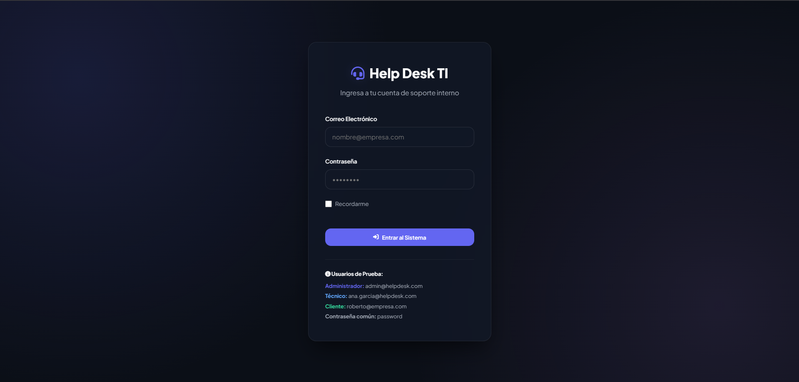
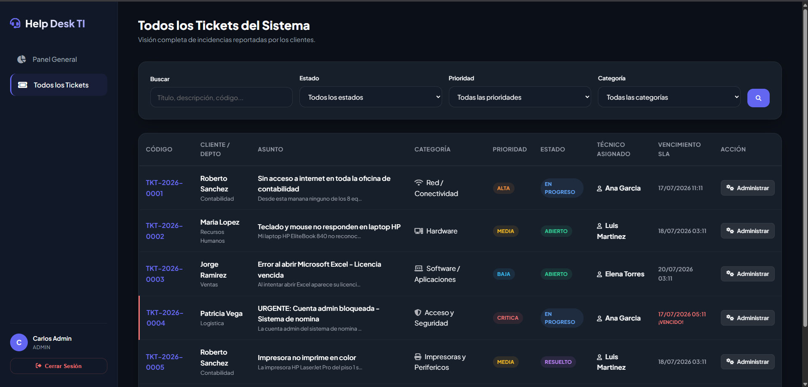
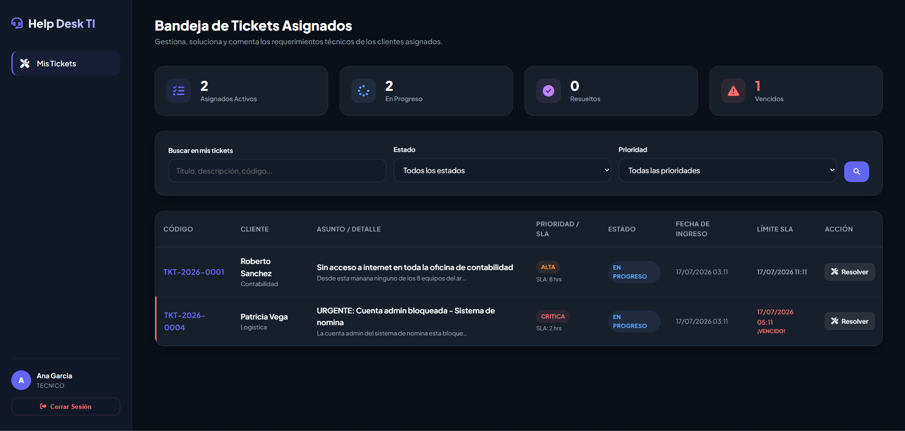
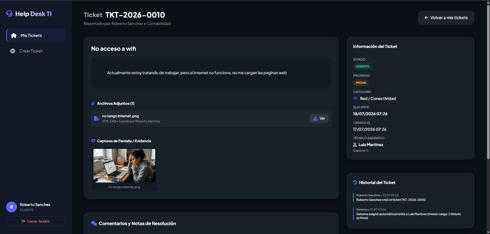

# IT Help Desk - Sistema de Gestión de Tickets de Soporte TI

<p align="center">
  
  
  
  
</p>

Una plataforma web interna para la gestión, priorización, asignación automática y auditoría de incidencias técnicas en infraestructura, hardware y software. Diseñada específicamente para conectar las necesidades del negocio con una resolución ágil de soporte TI.

---

## 🔍 Problemática Identificada

En los departamentos de soporte TI tradicionales, la gestión manual de incidencias presenta ineficiencias críticas:
1. **Asignación Desbalanceada y Cuellos de Botella**: Los coordinadores distribuyen los tickets de forma subjetiva u orientada al orden de llegada, sobrecargando a técnicos clave mientras otros están libres.
2. **Incumplimiento de SLA**: La falta de visibilidad en los tiempos máximos de respuesta (SLA) según la criticidad de la falla provoca que problemas urgentes (como caídas de servidores o bloqueos de nómina) queden relegados.
3. **Falta de Trazabilidad e Historial (Auditoría)**: En caso de cambios críticos (escalamiento de prioridad, cambio de técnico o reaperturas), no existe registro del responsable ni del estado anterior, dificultando auditorías de seguridad e informes de rendimiento.
4. **Fuga de Información**: Las notas técnicas internas que contienen diagnósticos delicados o contraseñas temporales terminan expuestas a los usuarios solicitantes (clientes).

---

## 💡 Solución Implementada

Este sistema responde a esas problemáticas a través de una arquitectura web ágil y robusta:

### 1. Control de Acceso Basado en Roles (RBAC)
- **Cliente (Empleado)**: Crea tickets, realiza seguimiento visual del estado, descarga/sube archivos adjuntos y añade comentarios públicos.
- **Técnico (Soporte)**: Gestiona su bandeja de tickets asignados, modifica el estado de los tickets, añade comentarios públicos y escribe notas internas privadas para el equipo de soporte.
- **Administrador (TI)**: Visualiza estadísticas generales (KPIs), administra la carga del equipo técnico, reasigna tickets manualmente y monitorea el log de auditoría completo del sistema.

### 2. Algoritmo de Asignación Automática Inteligente
Al ingresar un nuevo ticket, el backend analiza la carga activa en tiempo real:
- Realiza una consulta directa a la tabla `carga_tecnicos` buscando al técnico disponible con el menor número de `tickets_activos`.
- Asocia el ticket de forma inmediata e incrementa su contador en base de datos en una transacción atómica.
- Calcula el límite máximo de resolución (`due_at`) sumando las horas de SLA definidas por la prioridad del ticket.

### 3. Registro de Auditoría Detallado (Audit Trail)
Cada vez que un ticket es modificado (creación, cambio de prioridad, asignación manual o automática, y transiciones de estado), el sistema registra un log estructurado en la tabla `registro_auditoria_tickets` en formato JSON, capturando:
- El autor de la acción (o marca de "Sistema" si fue automático).
- El estado/valor anterior y el nuevo en formato JSON.
- Una descripción legible para humanos.
- La dirección IP del actor para garantizar la seguridad.

### 4. Reglas de Negocio Robustas
- **Cerrado y Bloqueo de Comentarios**: Una vez que un ticket es cerrado por el soporte, el formulario se bloquea para el cliente y el backend valida que no se puedan enviar más comentarios, evitando la reapertura descontrolada de hilos inactivos.
- **Ajuste de Prioridad y SLA**: El soporte o administrador puede redefinir la prioridad propuesta por el cliente, lo que recalcula automáticamente el tiempo límite de resolución (SLA) a partir de la fecha de creación del ticket y registra un evento de auditoría.
- **Galería de Evidencias Integrada**: Las imágenes y capturas de pantalla cargadas como adjuntos se previsualizan directamente en la ficha del ticket, permitiendo al soporte ver el fallo de inmediato sin descargas intermedias.
- **SLA e Indicador de Vencidos**: Visualización destacada en rojo neón cuando el ticket ha superado la fecha y hora límite de resolución sin ser solventado.
- **Validación de Calidad del Ticket**: Para evitar tickets vacíos o con palabras basura (como "asd"), el backend exige validación obligatoria de longitud mínima: al menos 8 caracteres para el asunto y 15 para el detalle del problema.

---

## 📸 Vista Previa (Capturas de Pantalla)

### Inicio de Sesión


### Panel de Administración (KPIs, Reasignador y Auditoría)


### Panel Técnico (Bandeja de Carga y Acciones de Soporte)


### Detalle de Ticket (Vista del Cliente con Evidencia e Imágenes)


---

## 🛠️ Tecnologías y Diseño Estético

- **Framework**: Laravel 10 (con PHP 8.1.25).
- **Base de Datos**: MySQL (Mapeada mediante modelos Eloquent con nombres de tablas en español y optimizaciones de integridad referencial).
- **Diseño Front-End (Bootstrap + CSS Vanilla)**: Interfaz de alta fidelidad con tema oscuro "Obsidian Dark Mode", gradientes sutiles de acento de colores de estado, efectos de vidrio esmerilado (Glassmorphism) y transiciones animadas fluidas de alto rendimiento.

---

## 🚀 Guía de Instalación y Despliegue

### Requisitos Previos
- **PHP**: >= 8.1
- **Composer**
- **Servidor MySQL** (WAMP/XAMPP recomendados)

### Paso 1: Clonar y Descargar Dependencias
```bash
# Entrar al directorio
cd 1.--Help-Desk

# Instalar dependencias de PHP
composer install
```

### Paso 2: Configuración del Entorno
Duplica el archivo `.env.example`, renombralo a `.env` y configura tus credenciales de base de datos MySQL local:
```env
DB_CONNECTION=mysql
DB_HOST=127.0.0.1
DB_PORT=3306
DB_DATABASE=helpdesk_db
DB_USERNAME=root
DB_PASSWORD=
```
Genera la clave de la aplicación:
```bash
php artisan key:generate
```

### Paso 3: Configurar la Base de Datos
Importa el script SQL de estructura y semillas pre-cargadas en tu servidor MySQL (puedes hacerlo usando phpMyAdmin o la consola MySQL):
- El archivo está ubicado en: `database/helpdesk_schema.sql`

*Nota: Este script creará la base de datos `helpdesk_db`, sus tablas, las prioridades básicas, categorías técnicas y 8 usuarios semilla con roles listos para pruebas.*

### Paso 4: Enlazar Almacenamiento y Servidor
Crea el enlace simbólico para poder ver las capturas y archivos adjuntos de los tickets:
```bash
php artisan storage:link
```
Inicia el servidor local de desarrollo:
```bash
php artisan serve
```
Abre en tu navegador la dirección: **http://127.0.0.1:8000**

---

## 🔑 Credenciales de Prueba (Contraseña Común: `password`)

El sistema incluye usuarios pre-cargados para validar los flujos de trabajo de inmediato:

| Nombre | Rol | Correo Electrónico | Descripción de Prueba |
|---|---|---|---|
| **Carlos Admin** | `Administrador` | `admin@helpdesk.com` | Dashboard con KPIs, auditoría global y reasignador manual. |
| **Ana García** | `Técnico` | `ana.garcia@helpdesk.com` | Técnico en soporte (con tickets asignados activos y cerrados). |
| **Luis Martinez** | `Técnico` | `luis.martinez@helpdesk.com` | Técnico en soporte TI secundario. |
| **Elena Torres** | `Técnico` | `elena.torres@helpdesk.com` | Técnico del departamento de Infraestructura. |
| **Roberto Sanchez** | `Cliente` | `roberto@empresa.com` | Empleado del área de contabilidad (puede reportar tickets). |
| **Maria Lopez** | `Cliente` | `maria@empresa.com` | Empleado del departamento de Recursos Humanos. |

---

## 👤 Autor

Desarrollado con dedicación por **David Valdés V.**
- **LinkedIn**: [David Valdés V.](https://www.linkedin.com/in/david-valdesv/)
- **GitHub**: [@DavidValdesV](https://github.com/DavidValdesV)

---

## 📄 Licencia

Este proyecto es de código abierto bajo los términos de la [Licencia MIT](LICENSE) de software libre.
